  
  <h1>Maycon Mota</h1>
  
<strong>Analista de Quality Assurance (QA)</strong> • 📍 Palmas, TO

  
  
  

---

### 📌 Perfil Profissional

Analista de QA com foco em elevar o padrão de qualidade e a resiliência de sistemas complexos, unindo formação em **Engenharia Agronômica** e atuação especializada em plataformas do setor do **agronegócio e conformidade socioambiental**. Experiência no ciclo completo de engenharia de testes: desde o refinamento de requisitos, estruturação de demandas e documentação técnica, até a arquitetura e implementação de suítes de testes automatizados escaláveis (Web, API e Performance) integradas a pipelines de CI/CD.

---

### 🛠️ Tech Stack & Ferramentas

#### 🧪 Automação de Testes & Performance

#### 💻 Linguagens & Banco de Dados

#### 🔌 APIs, CI/CD & Gestão

---

### ⚙️ Arquitetura & Especialidades de QA

* **Arquitetura de Automação:** Implementação de **Page Object Model (POM)** com herança de classes e **Data-driven testing** utilizando geradores dinâmicos de massa de dados válida (CPF/CNPJ, protocolos CAR/SICAR e documentos).
* **Manipulação de Fluxos & Segurança:** Interceptação de requisições, injeção dinâmica de tokens (`JWT` / `localStorage`) e construção de frameworks modulares customizados.
* **Evidências & Observabilidade:** Geração automatizada de relatórios executivos (HTML, JSON e PDF com gráficos via Matplotlib) e gravação de vídeos de execução com legendas dinâmicas.
* **Banco de Dados & APIs:** Validação de persistência, integridade referencial e consultas SQL/espaciais em **PostgreSQL/PostGIS** e **MySQL** (DBeaver e Database Client), além de testes de contrato via Postman, Insomnia, Thunder Client, REST Client e Swagger UI.
* **Governança & Processos:** Definição de critérios de aceite em **BDD (Gherkin)**, estruturação de User Stories (3C), checklists de Pull Request e acompanhamento de KPIs de Sprint no ClickUp e Jira.

---

### 🚀 Projetos & Realizações

* **Ecossistema de Automação SMGeo (E2E, API & Performance):** Implantação e desenvolvimento **do zero** de frameworks modulares de automação para múltiplas plataformas (SMGeo Direto, Consulta, Indireto, Sirflor, Prospec e Campo). A arquitetura contempla suítes E2E em Playwright/TypeScript e Cypress, automação de APIs em Python/Pytest (`aiohttp`) com injeção dinâmica de tokens JWT, validação rigorosa de contratos e geração automatizada de relatórios técnicos em PDF e evidências em vídeo.
* **Performance & Resiliência:** Planejamento e execução de testes de carga e estresse com **Locust** para validação de endpoints críticos sob alta concorrência, assegurando a estabilidade e disponibilidade das aplicações.
* **CI/CD & Padronização de Qualidade:** Estruturação de pipelines de execução contínua via **GitHub Actions** aliada à padronização da documentação técnica da equipe no ClickUp para garantir deploys seguros e reprodutibilidade das suítes.

---

### 🌐 Ecossistema & Plataformas Validados

Atuação direta na garantia de qualidade, testes funcionais/exploratórios, validação em banco de dados e automação E2E/API nas seguintes plataformas do agronegócio e monitoramento socioambiental:

* **SMGeo Direto:** Plataforma de análises socioambientais no agronegócio — validação de cadastros de produtores e propriedades rurais, cruzamento geoespacial (CAR/SICAR, PRODES, DETER, embargos do IBAMA) e automação de fluxos críticos end-to-end.
* **SMGeo Consulta:** Sistema de consulta e auditoria socioambiental e fiscal — validação de regras de negócio, pré-consultas, justificativas, conferência de notas fiscais e integridade de dados via consultas SQL (PostgreSQL/PostGIS).
* **SMGeo Indireto:** Plataforma de análises do agronegócio focada em **GTAs (Guias de Trânsito Animal)** — validação de rastreabilidade na movimentação de rebanhos, vínculos com fornecedores indiretos e conformidade socioambiental da cadeia pecuária.
* **Sirflor:** Sistema voltado para regularização ambiental e fundiária de propriedades rurais com foco em áreas com **PRODES e embargos no estado do Pará** — validação de regras territoriais, análise de passivos ambientais e conformidade geoespacial.
* **SMGeo Prospec:** Aplicação de verificação rápida em campo voltada para pecuaristas — validação de consultas ágeis de conformidade socioambiental, usabilidade (UI/UX) e integração de dados territoriais para suporte à tomada de decisão.
* **SMGeo Campo:** Aplicação voltada para coleta fiscal e verificação de infraestrutura da propriedade rural *in loco* — testes funcionais, validação de formulários, estabilidade de sincronização e integridade dos levantamentos de campo.

---

### 💡 Áreas de Interesse

* **Tecnologia & Agronegócio:** Intersecção entre inovação, geotecnologia, automação de software e sustentabilidade no campo.

---

### 📊 Contribuições no GitHub

  <picture>
    <source media="(prefers-color-scheme: dark)" srcset="https://raw.githubusercontent.com/MayconMT/MayconMT/output/pacman-contribution-graph-dark.svg">
    <source media="(prefers-color-scheme: light)" srcset="https://raw.githubusercontent.com/MayconMT/MayconMT/output/pacman-contribution-graph.svg">
    
  </picture>

